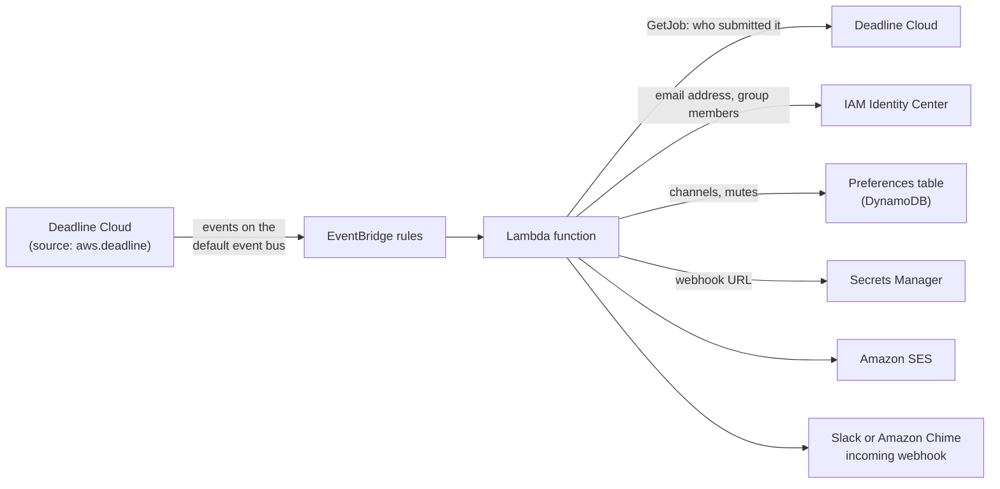

# AWS Deadline Cloud job notifications (AWS CDK)

This [AWS CDK](https://aws.amazon.com/cdk/) app tells the people involved in an [AWS Deadline Cloud](https://aws.amazon.com/deadline-cloud/) job when something needs their attention: the person who submitted a job hears when it fails, and a step's approvers hear when it is waiting for their approval. Each message goes to that person by email, Slack, or Amazon Chime, according to their own preferences, and links straight to the job or step in Deadline Cloud monitor.

The [CloudFormation job event Slack sample](../../../cloudformation/notification_templates/job_events_slack_lambda/) posts every job event to one channel. Choose this sample when messages should reach the individual who submitted the job or who has to act on it.

## What it notifies

| Deadline Cloud event | Notification | Sent to |
|---|---|---|
| `Job Run Status Change` to `FAILED` | Job failed | The job's submitter |
| `Step Run Status Change` to `FAILED` | Step failed, when `FailureNotificationLevel` is `STEP` | The job's submitter |
| `Task Run Status Change` to `FAILED` | Task failed, when `FailureNotificationLevel` is `TASK` | The job's submitter |
| `Step Approval Requested` | Step waiting for your approval | The step's approvers, with groups expanded to their members |
| `Step Approval Decided` | Step approved, rejected, or approval expired | The job's submitter, and the approvers when `NotifyApproversOfDecision` is `true` |

Failures are reported for the job by default. A job with a thousand tasks that fail sends one message, not a thousand. Set `FailureNotificationLevel` to `STEP` or `TASK` for finer-grained messages, or `NONE` to turn failure messages off.

Nobody is told about a decision they made themselves.

## How it works



1. EventBridge rules on the account's default event bus forward the failure and approval events to a Lambda function. Failure rules match `FAILED` only, so other status changes never invoke it.
2. The function works out who the event is for. Status change events do not name the job's submitter, so the function reads it from the job's `createdBy` with `deadline:GetJob`. Approval events name the approvers and the submitter themselves.
3. Each person is resolved to destinations:
   - An **IAM Identity Center user** gets the primary email address from the identity store, unless their preferences give another one.
   - An **IAM Identity Center group** is expanded to its members, at most 100 of them. A group with preferences of its own is also a recipient, which is how a team channel is notified.
   - An **IAM principal**, such as the role a pipeline submits jobs with, has no email address to look up. It is notified only when it has preferences, and skipped with a log line otherwise.
4. The function applies each person's preferences: the channels they want, an email address override, and the kinds of notification they have muted. People with no preferences get email.
5. It sends one message per destination. Two people who share a destination, such as a team Slack channel, get one message there.

EventBridge delivers each event at least once, so the same event can arrive twice. Before sending, the function claims the delivery in a DynamoDB table with a conditional write keyed on the notification and the destination, and skips any delivery that was already made. A message that fails for a reason a retry could fix, such as throttling or a network error, releases its claim and the invocation fails, so Lambda retries it twice. Messages that already went out are not sent again on the retry. A message that can never succeed, such as one to a deleted webhook, is recorded as failed and not retried. Anything still failing after every retry lands on a dead-letter queue with a CloudWatch alarm on it.

## Security

- **Nothing accepts inbound requests.** There is no function URL, no API, and no load balancer. The function is invoked only by the stack's EventBridge rules, and the jest tests assert that.
- **No message can approve anything.** Messages carry no approve or reject buttons and no one-click links. The only link in a message is to the job or step page in Deadline Cloud monitor, where the person signs in, reviews the step, and records their decision. A forwarded or leaked message grants nothing.
- **Messages say little.** By default a message says what happened and links to monitor, plus the job, step, or task ID. Job and step names are included only when you set `MessageDetail` to `NAMES`, since names can reveal confidential projects. An approval's message and links are never included, because they are free text and arbitrary URLs written by whoever submitted the job. Reviewers see them in monitor after signing in.
- **Webhook URLs are secrets.** A Slack or Chime webhook URL is all anyone needs to post to the channel, so each one is kept in AWS Secrets Manager. The preferences table holds only the secret's ARN, and the function's environment holds neither. The function can read only secrets under the stack's `WebhookSecretPrefix`, and posts only to `hooks.slack.com`, `hooks.slack-gov.com`, and `hooks.chime.aws`, over HTTPS, without following redirects.
- **Events cannot be forged.** The rules match the `aws.deadline` source, which only Deadline Cloud can publish to. Nobody in the account can call `events:PutEvents` to make the stack send messages.
- **Least privilege.** The function may call `deadline:GetJob` and `deadline:GetStep` on jobs, `identitystore:DescribeUser` and `identitystore:ListGroupMemberships` in the configured identity store, `dynamodb:GetItem` on the preferences table, write the delivery table, `secretsmanager:GetSecretValue` under the webhook prefix, and `ses:SendEmail` only from the configured sender address.
- **Logs hold no secrets.** Logs never contain a webhook URL, and email addresses are masked, such as `a***@example.com`.

Anyone who can write the preferences table can redirect another person's notifications, so treat it as administrator-only, like the rest of the stack.

## Email: why Amazon SES

The function sends each email individually with the [Amazon SES](https://aws.amazon.com/ses/) v2 `SendEmail` API. The alternative is an Amazon SNS topic with one email subscription per person and a filter policy on a recipient attribute. SES is the better fit for one-to-one messages:

- **Addressed by the sender, not by subscription.** SES sends to whoever the function resolves, including group members it has never seen before. With SNS, every person has to be subscribed ahead of time and click a confirmation link, and the subscriptions become a second preferences store to keep in sync with Identity Center.
- **A misconfiguration does not leak messages.** With SNS, a wrong or missing filter policy delivers one person's notifications to everyone on the topic. With SES, a message only ever goes to the address it was sent to.
- **Your domain, your deliverability.** SES sends from your own verified domain with DKIM, so messages come from an address people recognize rather than from `no-reply@sns.amazonaws.com`. Bounces and complaints are handled by the SES account-level suppression list.
- **Formatting.** SES sends HTML with a plain-text alternative. SNS email is plain text with an SNS footer and unsubscribe link.

SES needs a [verified identity](https://docs.aws.amazon.com/ses/latest/dg/creating-identities.html) for the sender, and new accounts start in the [SES sandbox](https://docs.aws.amazon.com/ses/latest/dg/request-production-access.html), which only delivers to verified addresses. Request production access before relying on email.

## Prerequisites

1. [Node.js](https://nodejs.org/) 20 or later.
2. AWS credentials for the account and Region your farm is in, and that account and Region [bootstrapped for CDK](https://docs.aws.amazon.com/cdk/v2/guide/bootstrapping.html) (`npx cdk bootstrap`).
3. Your Deadline Cloud monitor URL, such as `https://<name>.<region>.deadlinecloud.amazonaws.com`, which the [Deadline Cloud console](https://console.aws.amazon.com/deadlinecloud/home) shows once you have set up a monitor.
4. For email, an [Amazon SES verified identity](https://docs.aws.amazon.com/ses/latest/dg/creating-identities.html) to send from, in the same Region.
5. To look up email addresses and group members, the ID of the IAM Identity Center identity store your monitor uses, such as `d-1234567890`. Find it under **Settings** in the [IAM Identity Center console](https://console.aws.amazon.com/singlesignon/home).

## Deployment

```bash
cd cdk/notification_templates/job_notifications
npm ci
npx cdk deploy DeadlineJobNotifications \
  --parameters MonitorUrl=https://<name>.<region>.deadlinecloud.amazonaws.com \
  --parameters IdentityStoreId=d-1234567890 \
  --parameters SenderEmailAddress=render-notifications@studio.example.com
```

Change any parameter later by deploying again with a new value. Parameters you leave out keep their current values.

When the deployment finishes, it prints these outputs:

| Output | Description |
|---|---|
| `PreferencesTableName` | The DynamoDB table of notification preferences |
| `WebhookSecretPrefix` | The Secrets Manager name prefix webhook secrets are kept under |
| `FunctionName` | The notification function |
| `FunctionLogGroupName` | The function's log group, with a line for every event and delivery |
| `DeadLetterQueueUrl` | Events and invocations that failed after every retry |

## Parameters

| Parameter | Default | Description |
|---|---|---|
| `MonitorUrl` | (required) | Your Deadline Cloud monitor URL. Every message links to it |
| `SenderEmailAddress` | empty | The address email is sent from, an SES verified identity. Empty disables email |
| `IdentityStoreId` | empty | Your IAM Identity Center identity store. Empty means approvers are looked up in the store their approval event names, and a failed job's submitter is reached only through preferences |
| `IdentityStoreRegion` | this stack's Region | The Region of your IAM Identity Center instance, if different |
| `FailureNotificationLevel` | `JOB` | `JOB`, `STEP`, `TASK`, or `NONE` |
| `MessageDetail` | `MINIMAL` | `NAMES` adds job and step names to messages |
| `ApprovalLinkTarget` | `STEP_PAGE` | `APPROVAL_PAGE` links approval messages to monitor's approval review page, for a monitor version that has one |
| `NotifyApproversOfDecision` | `false` | Whether approvers are told about decisions as well as the submitter |

## Set notification preferences

Nobody needs preferences to get email: an Identity Center user with no preferences is emailed at their identity store address. Use preferences to choose other channels, mute kinds of notification, or reach an IAM principal. `scripts/preferences.ts` edits them, reading the table and secret prefix from the stack's outputs:

```bash
# Send Alex's notifications to Slack as well as email. The webhook URL is read
# from standard input, so it stays out of your shell history, and SLACK is added
# to Alex's channels.
npm run preferences -- webhook user:alex SLACK

# Alex doesn't want per-task failures.
npm run preferences -- set user:alex --mute TASK_FAILED

# Approvals for the Lighting Leads group also go to the team's channel.
npm run preferences -- webhook group:"Lighting Leads" SLACK

# The render pipeline's role submits jobs too. Email its owners when they fail.
npm run preferences -- set arn:aws:sts::111122223333:assumed-role/RenderPipeline/submitter \
  --email pipeline-team@studio.example.com

npm run preferences -- show user:alex
npm run preferences -- list
npm run preferences -- delete user:alex
```

Add `--stack <name>` if you deployed the stack under another name. A principal is `user:<user name>` or `group:<display name>` for Identity Center, looked up in the stack's identity store, an IAM ARN as it appears in a job's `createdBy`, or an Identity Center user or group ID. The notification kinds you can mute are `JOB_FAILED`, `STEP_FAILED`, `TASK_FAILED`, `APPROVAL_REQUESTED`, and `APPROVAL_DECIDED`. `--channels none` turns a person's notifications off, and `--channels default` returns them to email.

Create webhooks with [Slack incoming webhooks](https://api.slack.com/messaging/webhooks) or [Amazon Chime incoming webhooks](https://docs.aws.amazon.com/chime/latest/ug/webhooks.html). Amazon Chime has announced the end of its service, so prefer Slack for new setups.

The script needs `cloudformation:DescribeStacks` on the stack, read and write access to the preferences table, `secretsmanager:CreateSecret`, `PutSecretValue`, `TagResource`, and `DeleteSecret` under the webhook prefix, and `identitystore:GetUserId` and `GetGroupId` to look up names.

## Monitor links

Messages link to monitor's queue page with the job, step, or task selected, the same URL monitor builds when you click through to it:

```
https://<name>.<region>.deadlinecloud.amazonaws.com/<region>/farms/<farmId>/queues/<queueId>?jobId=<jobId>&stepId=<stepId>
```

With `ApprovalLinkTarget` set to `APPROVAL_PAGE`, approval messages link to the review page for the request instead, `.../queues/<queueId>/jobs/<jobId>/approval?stepId=<stepId>&approvalRequestId=<id>`.

## Test a deployment

Deadline Cloud events cannot be published by hand, because EventBridge reserves `aws.` sources for AWS services. To test end to end, deploy a separate copy of the stack that also matches a custom source, then publish events with that source:

```bash
npx cdk deploy NotificationsTest -c stackName=NotificationsTest \
  -c eventSources=aws.deadline,custom.deadline-test \
  --parameters MonitorUrl=https://<name>.<region>.deadlinecloud.amazonaws.com

aws events put-events --entries '[{
  "Source": "custom.deadline-test",
  "DetailType": "Job Run Status Change",
  "Detail": "{\"farmId\":\"farm-...\",\"queueId\":\"queue-...\",\"jobId\":\"job-...\",\"previousTaskRunStatus\":\"RUNNING\",\"taskRunStatus\":\"FAILED\"}"
}]'
```

Use the IDs of a real job, since the function reads its submitter. Then check the function's log group for the `Event processed` line. Don't add a custom source to the stack you rely on: anyone allowed to call `events:PutEvents` on the default event bus could then make it send messages.

A third context value, `deadlineEndpointUrl`, points `GetJob` at another Deadline Cloud API endpoint.

## Troubleshooting

Every event logs an `Event processed` line with how many recipients it resolved and what happened to each delivery. This [CloudWatch Logs Insights](https://docs.aws.amazon.com/AmazonCloudWatch/latest/logs/AnalyzingLogData.html) query over the `FunctionLogGroupName` log group shows why messages were not sent:

```
fields @timestamp, message, principalId, channel, reason
| filter ispresent(level) and (level != "INFO" or message = "Channel skipped for recipient")
| sort @timestamp desc
```

| Reason | Meaning |
|---|---|
| `IamPrincipalWithoutPreferences` | The job was submitted with IAM credentials and that principal has no preferences. Add some with `scripts/preferences.ts` |
| `EmailNotConfigured` | `SenderEmailAddress` is empty |
| `NoEmailAddress` | Nobody has an email address for this person: no identity store is configured, or the user has none |
| `IdentityStoreMismatch` | An approver is in a different identity store from `IdentityStoreId` |
| `MessageRejected` | SES refused the message, usually because the sender is not verified or the account is in the SES sandbox |
| `WebhookHttp404`, `WebhookHttp403` | The webhook was deleted or revoked. Store a new one |
| `WebhookHostNotAllowed` | The webhook secret holds a URL that is not a Slack or Chime webhook |

No `Event processed` line at all means the rules did not match. Check that the stack is in the farm's Region, and that `FailureNotificationLevel` is the level you expect.

## Development

```bash
npm run build    # type check with tsc
npm test         # jest tests: the function against in-memory fakes, and the synthesized template
npm run synth    # synthesize into cdk.out/
```

The function's code is in [`lambda/`](./lambda/), with every AWS call behind an interface in [`lambda/notify.ts`](./lambda/notify.ts), so [`test/lambda/`](./test/lambda/) runs the whole flow, including redelivery and retries, without AWS. [`test/job-notifications-stack.test.ts`](./test/job-notifications-stack.test.ts) asserts on the synthesized template. Both run in CI along with `cdk synth` and `cfn-lint`, configured in [`.github/workflows/cdk_checks.yml`](../../../.github/workflows/cdk_checks.yml).

## AWS User Notifications

[AWS User Notifications](https://docs.aws.amazon.com/notifications/latest/userguide/what-is-service.html) can match Deadline Cloud events and deliver them to email contacts, chat channels, and the AWS Console Mobile Application, with no code. It sends every matching event to the same contacts, so it suits team-wide alerts, such as every failed job on a queue going to a wrangler channel. It cannot work out who submitted a job or who approves a step. Use this sample when messages should go to those people.

## Cost and cleanup

At rest the stack costs close to nothing: the function, rules, tables, and queue are billed per use, and the CloudWatch alarm and any webhook secrets have small monthly charges. See [Secrets Manager pricing](https://aws.amazon.com/secrets-manager/pricing/) and [Amazon SES pricing](https://aws.amazon.com/ses/pricing/).

```bash
npx cdk destroy DeadlineJobNotifications
```

That deletes the preferences and delivery tables too. Webhook secrets are created by the script rather than the stack, so delete them separately, from the [Secrets Manager console](https://console.aws.amazon.com/secretsmanager/home) or with `npm run preferences -- delete <principal>` before you destroy the stack.
